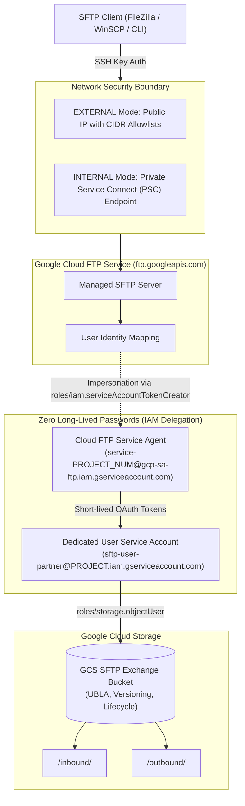

# Managed SFTP on Google Cloud (Cloud FTP) Architecture

Based on Alistair Grew's architecture design (*"Managed SFTP on Google Cloud: For the protocol that refuses to die..."*), this solution provisions Google Cloud's fully managed, cloud-native SFTP service (`ftp.googleapis.com`) interfacing directly with Google Cloud Storage.

---

## 1. Architectural Highlights



---

## 2. Core Security & Design Principles

1. **Zero Static Long-Lived Passwords:**
   - Password authentication is prohibited.
   - All authentication is performed via OpenSSH public/private key pairs.
2. **Service Account Delegation & Short-Lived Tokens:**
   - SFTP users do not hold static GCP service account keys.
   - The Cloud FTP Service Agent (`ftp.googleapis.com`) generates short-lived access tokens dynamically by assuming the dedicated customer service account (`roles/iam.serviceAccountTokenCreator`).
3. **Least-Privilege Object Storage Scope:**
   - The customer service account only possesses `roles/storage.objectUser` on the designated SFTP bucket.
4. **Dual Network Topologies Supported:**
   - **EXTERNAL:** Public IP bound to strict CIDR allowlist (`allowed_cidr_blocks`).
   - **INTERNAL:** Private Service Connect (PSC) endpoint inside a dedicated VPC (`consumer_accept_list`), keeping file exchange strictly private.
5. **Observability & Auditing:**
   - Cloud Audit Logs (`ADMIN_READ`, `DATA_READ`, `DATA_WRITE`) enabled for `ftp.googleapis.com`.

---

## 3. Terraform Resources Created

| Resource | Type | Purpose |
| :--- | :--- | :--- |
| `google_project_service.ftp_api` | Service | Enables `ftp.googleapis.com` |
| `google_storage_bucket.sftp_storage_bucket` | Storage | Enterprise GCS bucket with UBLA, versioning, and 90-day archive lifecycle |
| `google_service_account.sftp_user_sa` | IAM | Scoped user service account mapped to the SFTP identity |
| `google_storage_bucket_iam_member.sftp_sa_bucket_access` | IAM Member | Scopes bucket access (`roles/storage.objectUser`) |
| `google_project_service_identity.ftp_service_agent` | Service Identity | Generates the Cloud FTP Google-managed service agent |
| `google_service_account_iam_member.ftp_service_agent_token_creator` | IAM Member | Authorizes service agent with `roles/iam.serviceAccountTokenCreator` |
| `google_storage_ftp_server.sftp_server` | Managed SFTP | Deploys managed SFTP server supporting EXTERNAL or INTERNAL PSC mode |
| `google_storage_ftp_user.sftp_user` | Managed SFTP User | Configures username, SSH public key, and directory mappings (`/` to bucket) |
| `google_project_iam_audit_config.ftp_audit_logs` | Audit Config | Enforces data access logging on SFTP operations |
| `tls_private_key.sftp_client_key` | TLS/Crypto | Generates a 4096-bit RSA key pair automatically if no custom key is passed |

---

## 4. How to Connect

Once deployed via `terraform apply`:

### Via OpenSSH CLI:
```bash
# If using the Terraform-generated private key:
terraform output -raw cloud_ftp_private_key_pem > sftp_key.pem
chmod 600 sftp_key.pem

# Retrieve the server endpoint (IP or DNS)
SFTP_HOST=$(terraform output -raw cloud_ftp_server_ip_or_attachment)
SFTP_USER=$(terraform output -raw cloud_ftp_username)

# Connect via standard SFTP
sftp -i sftp_key.pem -P 22 ${SFTP_USER}@${SFTP_HOST}
```

### Via GUI Clients (FileZilla / Cyberduck):
- **Protocol:** `SFTP - SSH File Transfer Protocol`
- **Host:** Cloud FTP Server IP (or PSC Endpoint IP)
- **Port:** `22`
- **Logon Type:** `Key File`
- **User:** Value of `cloud_ftp_username` (e.g. `partner-upload`)
- **Key File:** Select your generated `.pem` / OpenSSH private key

